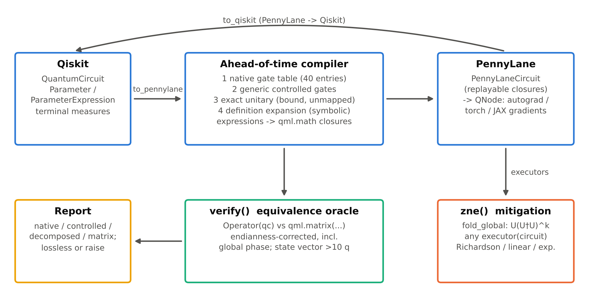
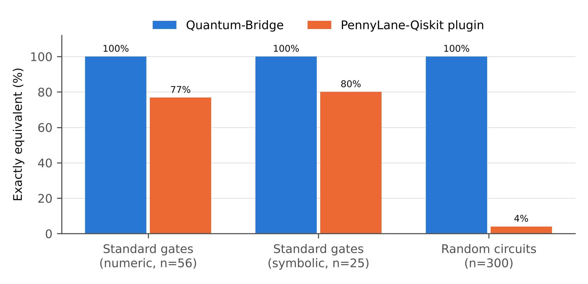

# Quantum-Bridge

**Lossless Qiskit ⇄ PennyLane circuit translation with a built-in equivalence check, plus dependency-free zero-noise extrapolation (ZNE).**

[](tests/)   [](https://doi.org/10.5281/zenodo.23638876)

> 🇹🇷 Türkçe açıklama için: [README.tr.md](README.tr.md)

Researchers lose time on glue work: rewriting a Qiskit ansatz by hand so that PennyLane can differentiate it, keeping track of Qiskit's little-endian bit order, and re-implementing error mitigation for every project. Quantum-Bridge turns that into one line each and **proves** that the result is exact.

```python
import qbridge as qb

node = qb.to_qnode(qiskit_circuit, observable="ZZI")   # Qiskit → differentiable PennyLane QNode
qc   = qb.to_qiskit(pennylane_qfunc, *params)          # PennyLane → Qiskit QuantumCircuit
qb.verify(qiskit_circuit)                              # EQUIVALENT via unitary: max |error| = 1e-16
qb.zne(bound_circuit, executor)                        # zero-noise-extrapolated expectation value
```



## Why another converter?

The official [PennyLane-Qiskit plugin](https://github.com/PennyLaneAI/pennylane-qiskit) (`qml.from_qiskit`) is the natural first choice. Quantum-Bridge was built for the cases where **being exactly right matters more than being lazy**:

| | Quantum-Bridge | PennyLane-Qiskit 0.45.0 |
|---|---|---|
| Qiskit standard gates exactly reproduced (numeric) | **56 / 56** | 43 / 56 |
| … with symbolic parameters | **25 / 25** | 20 / 25 |
| Random circuits (n = 300, 2–7 qubits, depth 20) exact | **300 / 300** | 12 / 300 |
| Global phase preserved | **yes** | no |
| PennyLane → Qiskit direction | **yes** | – |
| Equivalence check + conversion report | **yes** | – |
| Gradients on library ansätze (vs. finite differences) | ≤ 1.5·10⁻¹⁰ | ≤ 1.5·10⁻¹⁰ |
| Extra dependencies | sympy | qiskit-aer, qiskit-ibm-runtime, … |

*Measured with Qiskit 2.3.0 / PennyLane 0.45.1 / Python 3.13 (`benchmarks/bench_interop.py`).* The plugin failures come from un-mapped multi-qubit gates being embedded as `QubitUnitary` without reversing Qiskit's little-endian qubit order, which changes measurable probabilities — see the 20-line reproducer in [`benchmarks/plugin_wire_order_repro.py`](benchmarks/plugin_wire_order_repro.py). On circuits made only of commonly mapped gates (e.g. `RealAmplitudes`, `EfficientSU2`, `ZZFeatureMap`) both tools agree to machine precision.



**Trade-off, honestly:** Quantum-Bridge compiles the circuit ahead of time (0.6 ms for 63 gates, 19 ms for 2 078 gates) and its QNode execution is 1.1–1.6× slower than the plugin's on `default.qubit` in our scaling benchmark (Fig. 3 in `benchmarks/figures`).

## How it stays exact

Every Qiskit instruction goes through four tiers, and **anything that cannot be translated exactly raises `UnsupportedOperationError` instead of being approximated** (mid-circuit measurement, reset, classical control flow):

1. **native** – one of 40 named gate correspondences (each checked by a unit test against the full unitary, including phase);
2. **controlled** – a generic `qml.ctrl` over a mapped base gate, honouring `ctrl_state`;
3. **matrix** – fully bound, unmapped gates become `QubitUnitary` on *reversed* wires (endianness handled);
4. **decomposed** – unmapped *symbolic* gates are expanded through Qiskit's own definition, so they stay differentiable.

`ParameterExpression`s such as `(π − x₀)(π − x₁)` are compiled once into `qml.math` closures, so gradients flow under autograd, PyTorch, JAX or TensorFlow.

```text
>>> print(qb.to_pennylane(qc).report)
Quantum-Bridge conversion report (qiskit -> pennylane)
  native          1   [h]
  controlled      1   [cs]
  decomposed      1   [rzx]
  matrix          1   [xx_plus_yy]
  skipped         4   [barrier, measure]
  global phase kept: 0.250000
  status: lossless (exact unitary preserved)
```

## From 10+ lines to 2

| Task | Before (hand-written) | After | Files |
|---|---|---|---|
| Use a Qiskit ansatz in PennyLane with gradients | 21 lines (14 of translation logic) | 8 lines (**1** of logic) | [`before_01`](examples/before_01_manual_translation.py) → [`after_01`](examples/after_01_manual_translation.py) |
| Zero-noise extrapolation of a Qiskit circuit | 18 lines (11 of logic) | 6 lines (**1** of logic) | [`before_02`](examples/before_02_zne.py) → [`after_02`](examples/after_02_zne.py) |

The hand-written version is also fragile: calling `.decompose()` on `real_amplitudes` in Qiskit 2.x emits `r` gates instead of `ry`, and the manual translator above crashes with `NotImplementedError: r`. Quantum-Bridge handles it.

## Error mitigation in one line

```python
noisy = qb.depolarizing_executor("ZZZ", p1=0.002, p2=0.02)   # or wrap any real backend
print(qb.zne(qc, noisy, scale_factors=(1, 3, 5), method="richardson", return_result=True))
# ZNE (richardson) -> -0.234051  (unmitigated -0.190762; λ=1.00: -0.19076, λ=3.00: -0.12278, λ=5.00: -0.07961)
# ideal reference: -0.241614
```

`zne()` works on **any** `executor(QuantumCircuit) -> float`, so it plugs into Qiskit primitives, cloud backends or simulators. Our Richardson results match PennyLane's built-in `mitigate_with_zne` to < 5·10⁻¹⁵ on identical noise.

| Ansatz (20 random instances) | p₂ | Unmitigated MAE | Linear | Richardson | Exponential |
|---|---|---|---|---|---|
| RealAmplitudes, 3 q | 0.01 | 0.0443 | 0.0139 | 0.0052 | **0.0047** |
| RealAmplitudes, 3 q | 0.02 | 0.0725 | 0.0349 | 0.0115 | **0.0084** |
| EfficientSU2, 3 q | 0.01 | 0.0290 | 0.0096 | 0.0035 | **0.0033** |
| EfficientSU2, 3 q | 0.02 | 0.0638 | 0.0330 | 0.0107 | **0.0077** |
| RealAmplitudes, 4 q | 0.01 | 0.0319 | 0.0125 | 0.0046 | **0.0041** |
| RealAmplitudes, 4 q | 0.02 | 0.0780 | 0.0474 | 0.0159 | **0.0098** |

ZNE trades bias for variance: with 4 096 shots per circuit, Richardson removes almost all bias (0.035 → −0.0006) but raises the standard deviation from 0.016 to 0.022 (`benchmarks/bench_zne.py`).

## Quantum machine learning example

[`examples/04_qml_classifier_with_zne.py`](examples/04_qml_classifier_with_zne.py) builds a classifier entirely in Qiskit (`zz_feature_map` + `real_amplitudes`), trains it with PennyLane autograd through the bridge, then evaluates it on noisy simulators. ZNE (Richardson) cuts the deviation of the model output from its noise-free value by 12× at p₂ = 0.01 and 2.6× at p₂ = 0.05.

## Install & test

```bash
git clone https://github.com/sumeyyenuresin/quantum-bridge && cd quantum-bridge
pip install -e ".[dev]"
pytest            # 191 tests: every standard gate, random circuits, gradients, round trips, ZNE
```

Reproduce all numbers and figures:

```bash
pip install pennylane-qiskit            # only needed for the comparison
python benchmarks/bench_interop.py
python benchmarks/bench_zne.py
python benchmarks/make_figures.py
```

## API

| Function | Purpose |
|---|---|
| `to_pennylane(qc, wires=None, keep_global_phase=True)` | Qiskit circuit → reusable PennyLane quantum function (`.parameters`, `.report`, `.apply`) |
| `to_qnode(qc, device=None, observable=None, diff_method="best")` | One-liner QNode. `observable=None` returns probabilities in **Qiskit bit order** |
| `to_qiskit(qfunc_or_tape, *args, wire_order=None, measure=False)` | PennyLane → Qiskit |
| `verify(qc, pl_circuit=None, values=None, up_to_global_phase=False)` | Numerical equivalence proof (unitary ≤ 10 qubits, state vector beyond) |
| `zne(qc, executor, scale_factors=(1,3,5), method="richardson")` | Zero-noise extrapolation; methods: `linear`, `richardson`, `quadratic`, `exponential` or a callable |
| `fold_global(qc, scale)` | Unitary folding, incl. fractional scales |
| `depolarizing_executor(obs, p1, p2, readout, shots)`, `ideal_executor(obs)` | Ready-made executors |

Observables accept Qiskit-order Pauli strings (`"ZZI"`), `Pauli`, `SparsePauliOp` or PennyLane operators.

## Limitations

- Mid-circuit measurement, reset and classical control flow are rejected rather than approximated.
- ZNE assumes noise that grows with gate count; it does not mitigate readout error and amplifies shot noise.
- Benchmarks are simulator-only; hardware validation is future work.

## Citing

See [`CITATION.cff`](CITATION.cff). A manuscript describing the design and benchmarks has been submitted to *Computer Physics Communications*.

**Author:** Sümeyye Nur Esin ([ORCID 0009-0000-6987-9787](https://orcid.org/0009-0000-6987-9787)), Department of Computer Engineering, Sakarya University of Applied Sciences

## License

MIT
